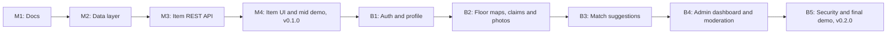

# Product Requirements Document (PRD): LostSpot

| | |
|---|---|
| **Product** | LostSpot |
| **Document** | Product Requirements Document (PRD) |
| **Version** | 1.1 |
| **Date** | 4 November 2026 |
| **Author** | Rifat |
| **Related docs** | [SRS](02-srs.md) · [TDD](03-tdd.md) |

---

## 1. Overview

LostSpot is a lost and found web app for a university campus that is built around **location**. Every post says where the item was lost or found. The MVP stores the location as text (building, floor, room). In Beta, every item is placed on a **floor map of a building**: a person who lost something marks the area where they think it happened, and a person who found something drops a pin exactly where it was lying.

Example:

> 🔑 **Lost:** Black car key
> 📍 Computer Science Building, Floor 2, around Lab 1 and the corridor
> 🕐 Between 3:00 PM and 4:00 PM

Someone who finds the key can open the same floor, see the lost post, and report it as found.

## 2. Release plan

The product is built in two releases. Every feature, story and milestone in this document is tagged **MVP** or **Beta**.

| Release | When | Tag | Focus |
|---|---|---|---|
| **MVP** | Demo before mid-term | `v0.1.0` | Lost and found item CRUD: post an item with its location and date, list, view, edit, mark resolved, delete. No accounts. |
| **Beta** | Demo before final | `v0.2.0` | Accounts with university email, building floor maps with pins and areas, claim flow with a verification question, match suggestions, photos, admin dashboard and moderation, security hardening. |

## 3. Problem statement

On most campuses, lost and found happens in social media groups, chat groups, or a logbook at the security desk. These have the same weaknesses:

- Posts scroll away within hours, so a key found on Tuesday is invisible by Thursday.
- Locations are vague ("somewhere in the CS building"), so a finder cannot tell whether the thing in their hand matches a post.
- There is no simple way to prove ownership, so anyone can say "that's mine."
- Nothing is searchable by place, which is the one thing both sides usually know something about.

## 4. Goals

| ID | Goal | Release |
|---|---|---|
| G-01 | Let anyone post a lost or found item in under a minute, with where and when it happened. | MVP |
| G-02 | Keep one list of every lost and found item on campus, newest first, that can be filtered. | MVP |
| G-03 | Let posts be corrected, marked as resolved when the item is back with its owner, and deleted. | MVP |
| G-08 | Place items on building floor maps, so people can check the exact area they were in. | Beta |
| G-04 | Tie posts to verified university accounts to reduce spam and fake posts. | Beta |
| G-05 | Reduce false claims with a hidden verification question on found items. | Beta |
| G-06 | Suggest likely matches between lost and found items automatically. | Beta |
| G-07 | Give admins (for example the security desk) tools to moderate posts and users. | Beta |

## 5. Target users

| User | Description | Main need |
|---|---|---|
| **Student who lost an item** (owner) | Remembers roughly where and when they lost something. | Post quickly, get notified or find it on the map, prove the item is theirs. |
| **Student who found an item** (finder) | Knows exactly where the item was and where they left it. | Post in a few taps, hand the item to the right person. |
| **Visitor** | Anyone browsing without an account. | Look at the map and the list. |
| **Admin / security desk** | Staff or club members who run the service. | Remove bad posts, ban abusers, add buildings and floor plans, see usage. |

## 6. Scope

### 6.1 In scope

| Release | In scope |
|---|---|
| **MVP** | Lost and found item posts with type, title, location (text), date, description and contact; create, list, view, edit, delete; mark resolved and reopen; filter by lost or found and hide resolved; clear all resolved items; no accounts; deployment on Vercel with Supabase PostgreSQL. |
| **Beta** | Sign up and login with a university email (JWT and refresh token); profile (change name and password); "my posts"; `user` and `admin` roles; buildings and floors with floor maps (pins for found items, areas for lost items); categories and search; photo upload; verification question and claim flow on found items; match suggestions; admin dashboard with stats; remove posts; ban and unban users; add buildings and floor plans; rate limiting, login lockout and other security hardening. |

### 6.2 Out of scope (this semester)

- Automated tests and CI/CD
- Native mobile apps
- Email or push notifications
- In-app chat between users
- Indoor positioning (GPS / Wi-Fi location)
- Multiple campuses

## 7. Features

Priority uses MoSCoW: **M**ust, **S**hould, **C**ould, **W**on't (this semester).

| ID | Feature | Priority | Release |
|---|---|---|---|
| F-01 | Post a lost or found item with title, location, date, description and contact | Must | MVP |
| F-02 | List of all items, newest first, with "Load more" | Must | MVP |
| F-03 | Item details page | Must | MVP |
| F-04 | Edit an item | Must | MVP |
| F-05 | Mark an item resolved or open again | Must | MVP |
| F-06 | Delete an item, and clear all resolved items at once | Must | MVP |
| F-07 | Filter the list by lost or found, and hide resolved items | Should | MVP |
| F-08 | Building floor maps with pins (found) and areas (lost), categories and search | Must | Beta |
| F-09 | Sign up / login with university email, JWT + refresh token | Must | Beta |
| F-10 | Profile: change name and password, see my posts | Must | Beta |
| F-11 | Roles `user` / `admin` | Must | Beta |
| F-12 | Verification question and claim flow on found items | Must | Beta |
| F-13 | Match suggestions between lost and found items | Should | Beta |
| F-14 | Photo upload on items | Should | Beta |
| F-15 | Admin dashboard with stats | Should | Beta |
| F-16 | Admin: remove posts, ban / unban users | Must | Beta |
| F-17 | Admin: add buildings and floor plans | Should | Beta |
| F-18 | Security hardening (rate limits, lockout, headers, CORS) | Must | Beta |
| F-19 | "Hotspot" heatmap of where items are lost most | Could | Beta |
| F-20 | Email notifications when a match appears | Won't | – |

## 8. User stories

### 8.1 MVP

| ID | User story |
|---|---|
| US-01 | As a student who lost something, I want to post a lost item with a title, where I lost it and when, so that others know what to look out for. |
| US-02 | As a finder, I want to post a found item with where I found it and where I left it, so that the owner can collect it. |
| US-03 | As a visitor, I want to see all lost and found items, newest first, and show only lost or only found, so that I can quickly check whether my item is there. |
| US-04 | As a visitor, I want to open an item and see all its details, so that I can decide if it is mine or one I found. |
| US-05 | As a poster, I want to edit my item, so that I can fix mistakes or add details. |
| US-06 | As a poster, I want to mark my item as resolved, or open it again, so that people know whether it is still missing. |
| US-07 | As a poster, I want to delete my item, so that wrong or old posts disappear. |
| US-08 | As a visitor, I want to hide resolved items or clear them all at once, so that the list only shows items still in play. |
| US-09 | As a visitor, I want to load more items when the list is long, so that the page stays fast. |

### 8.2 Beta

| ID | User story |
|---|---|
| US-10 | As a student, I want to sign up with my university email, so that only campus members can post. |
| US-11 | As a user, I want to log in and stay logged in, so that I don't have to sign in every time. |
| US-12 | As a user, I want to change my name and password, so that my account stays correct and secure. |
| US-13 | As a user, I want to see all my posts in one place, and only I (or an admin) can change them, so that strangers can't edit or delete my posts. |
| US-14 | As an owner, I want to claim a found item by answering the finder's verification question, so that I can prove it is mine. |
| US-15 | As a finder, I want to review claims on my found item and approve or reject them, so that the item goes back to the right person. |
| US-16 | As an owner, I want to see suggested found items that match my lost item, so that I don't have to search manually. |
| US-17 | As a poster, I want to add a photo to my item, so that it is easier to recognise. |
| US-18 | As an admin, I want a dashboard with item and user stats, so that I can see how the service is being used. |
| US-19 | As an admin, I want to remove posts that break the rules, so that the map stays clean. |
| US-20 | As an admin, I want to ban and unban users, so that I can stop abuse. |
| US-21 | As an admin, I want to add buildings and upload floor plans, so that LostSpot can grow to more of the campus. |
| US-22 | As a student who lost something, I want to mark the area on a floor map where I think I lost it, so that finders can compare it with where they found things. |
| US-23 | As a visitor, I want to pick a building and floor and see open items on its map, so that I can check the places I was in. |

## 9. Success metrics

| Release | Metric | Target |
|---|---|---|
| MVP | Full CRUD flow (post → list → view → edit → resolve → delete) works in the live demo on Vercel | 100% of demo steps succeed |
| MVP | Time to post an item, measured with 3 classmates | Under 60 seconds |
| MVP | Item list loads | Under 2 seconds on a normal connection |
| MVP | Items still there after a redeploy (Supabase) | 100% |
| Beta | Test users who complete the claim flow without help | At least 4 out of 5 |
| Beta | Match suggestions return the correct item in prepared demo scenarios | At least 8 out of 10 |
| Beta | Protected endpoints rejecting the wrong role in a manual check | 100% |
| Beta | Secrets committed to Git | 0 |

## 10. Milestones

| ID | Milestone | Release | Deliverable |
|---|---|---|---|
| M1 | Docs | MVP | PRD, SRS, TDD and README merged into `main` |
| M2 | Data layer | MVP | `item` model, database connection (SQLite locally, Supabase in production) |
| M3 | Item REST API | MVP | Item CRUD endpoints under `/api/v1/items`, API docs at `/api/docs` |
| M4 | Item UI and mid demo | MVP | React pages for list, details, create, edit and delete, deployed on Vercel, tagged `v0.1.0` |
| B1 | Auth and profile | Beta | Register, login, refresh, logout, profile, my posts |
| B2 | Floor maps, claims and photos | Beta | Buildings, floors and floor maps; verification question, claim flow, photo upload |
| B3 | Match suggestions | Beta | Matches endpoint and "possible matches" panel |
| B4 | Admin dashboard and moderation | Beta | Stats, remove posts, ban / unban, buildings and floors |
| B5 | Security and final demo | Beta | Rate limits, lockout, headers, CORS; tagged `v0.2.0` |

## 11. Assumptions and constraints

- The project is built by a student within one semester, so scope is kept to one campus and a few buildings.
- Floor plans (Beta) are simple images (PNG or SVG) drawn or traced by the team; they don't need to be architecturally exact.
- Free tiers of Vercel and Supabase are enough for the expected traffic.
- In the MVP there are no accounts, so anyone can edit or delete any post. This is accepted for the mid-term demo and fixed by accounts in Beta.
