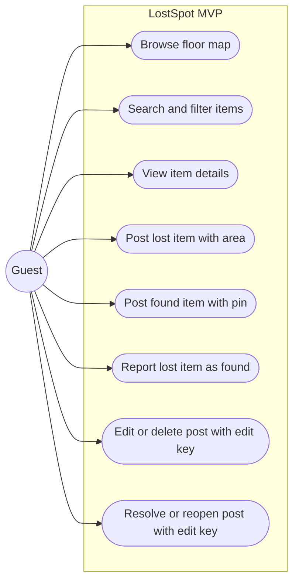
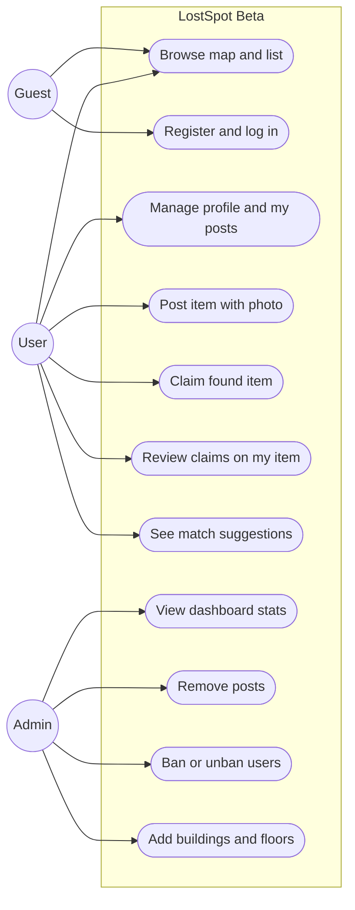
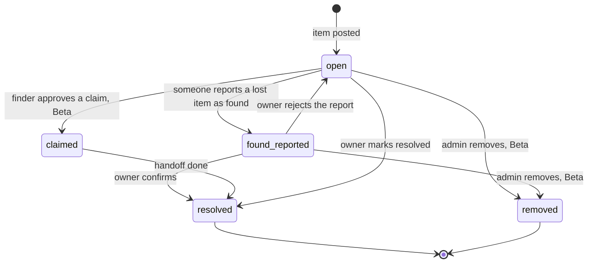

# Software Requirements Specification (SRS): LostSpot

| | |
|---|---|
| **Product** | LostSpot |
| **Document** | Software Requirements Specification (SRS) |
| **Version** | 1.0 |
| **Date** | 13 October 2026 |
| **Author** | Rifat |
| **Related docs** | [PRD](01-prd.md) · [TDD](03-tdd.md) |

---

## 1. Introduction

### 1.1 Purpose

This document lists what LostSpot must do (functional requirements) and how well it must do it (non-functional requirements). It is the reference for building and checking the system. Every requirement has an ID, a release (MVP or Beta) and a link back to a user story in the [PRD](01-prd.md).

### 1.2 Scope

LostSpot is a web app where people post lost and found items on a building floor map. The MVP covers posting, browsing, filtering, reporting found and resolving, without accounts. Beta adds accounts, roles, claims with a verification question, match suggestions, photos and admin tools. Out of scope: automated tests, CI/CD, native apps, notifications, chat, indoor positioning.

### 1.3 Definitions

| Term | Meaning |
|---|---|
| **CRUD** | Create, Read, Update, Delete. |
| **REST** | An API style where resources are reached by URL and HTTP methods (`GET`, `POST`, `PATCH`, `DELETE`). |
| **JWT** | JSON Web Token. A signed token that proves who the user is. |
| **Refresh token** | A long-lived token used to get a new access token without logging in again. |
| **RBAC** | Role-based access control. What a user can do depends on their role. |
| **Item** | A lost or found post. Its `type` is `lost` or `found`. |
| **Pin** | An exact point on a floor plan, stored as `x` and `y` between 0 and 1. |
| **Lost area** | A circle on the floor plan (centre `x`, `y` and `radius`) showing where the owner thinks the item was lost. |
| **Found report** | A note from someone saying they found a lost item (MVP). |
| **Claim** | A request from a user saying a found item is theirs, with an answer to the verification question (Beta). |
| **Match** | A found item that fits a lost item by floor, category, area and time (Beta). |
| **Edit key** | A random secret given once when a post is created in the MVP. It is needed to edit, delete, resolve or reopen that post. |
| **Owner / poster** | The person who created a post. |

### 1.4 Roles

| Role | Release | Description |
|---|---|---|
| `guest` | MVP, Beta | Not logged in. In the MVP everyone is a guest. |
| `user` | Beta | Logged-in account with a verified university email. |
| `admin` | Beta | User with moderation and management rights. |

"Owner" is not a role. It means the user who created a given item. Some actions are allowed only for the owner of that item.

## 2. Overall description

### 2.1 Use cases, MVP

### 2.2 Use cases, Beta

An admin can also do everything a user can.

### 2.3 Item status

| Status | Meaning | Applies to |
|---|---|---|
| `open` | Still lost or still waiting for its owner. | lost, found |
| `found_reported` | Someone says they found this lost item. | lost |
| `claimed` | Finder approved a claim; handoff pending. | found (Beta) |
| `resolved` | Item is back with its owner. Hidden from the map by default. | lost, found |
| `removed` | Taken down by an admin. Hidden everywhere except the admin view. | lost, found (Beta) |

## 3. Functional requirements

### 3.1 MVP

| ID | Requirement | Release | Story |
|---|---|---|---|
| FR-01 | The system shall list all buildings. | MVP | US-04 |
| FR-02 | The system shall list the floors of a building, each with its floor plan image and size. | MVP | US-04 |
| FR-03 | A guest shall be able to create a **lost** item with title, category, description, floor, lost area (`x`, `y`, `radius`), time window (`time_from`, `time_to`) and optional contact. | MVP | US-01, US-02 |
| FR-04 | A guest shall be able to create a **found** item with title, category, description, floor, exact pin (`x`, `y`), time found (`time_from`), handoff note and optional contact. | MVP | US-03 |
| FR-05 | On creation the system shall return a random edit key once, and store only its hash. | MVP | US-08 |
| FR-06 | The system shall show items of the selected floor on its map: found items as pins, lost items as circles. Only `open` and `found_reported` items are shown by default. | MVP | US-04 |
| FR-07 | The system shall list items with filters for `type`, `category`, `building_id`, `floor_id`, `status`, date range and a text search on title and description, with pagination. | MVP | US-05 |
| FR-08 | The system shall return the full details of a single item. | MVP | US-06 |
| FR-09 | A guest shall be able to report an `open` lost item as found with a note. The item moves to `found_reported`. | MVP | US-07 |
| FR-10 | With a valid edit key, the poster shall be able to update their item's fields. | MVP | US-08 |
| FR-11 | With a valid edit key, the poster shall be able to delete their item. | MVP | US-08 |
| FR-12 | With a valid edit key, the poster shall be able to mark their item `resolved`. | MVP | US-09 |
| FR-13 | With a valid edit key, the poster shall be able to move a `found_reported` item back to `open` and clear the found report. | MVP | US-09 |
| FR-14 | The system shall provide a seed script that creates at least one building with two floors and their floor plans. | MVP | US-04 |

### 3.2 Beta

| ID | Requirement | Release | Story |
|---|---|---|---|
| FR-15 | A guest shall be able to register with name, email and password. Only emails from allowed university domains are accepted. | Beta | US-10 |
| FR-16 | A user shall be able to log in and receive an access token and a refresh token. | Beta | US-11 |
| FR-17 | A user shall be able to get a new token pair with a valid refresh token; the old refresh token is revoked (rotation). | Beta | US-11 |
| FR-18 | A user shall be able to log out, which revokes their refresh token. | Beta | US-11 |
| FR-19 | A user shall be able to view their profile and change their name. | Beta | US-12 |
| FR-20 | A user shall be able to change their password by giving the current one. All their refresh tokens are revoked afterwards. | Beta | US-12 |
| FR-21 | A user shall be able to list all their own items. | Beta | US-13 |
| FR-22 | Creating an item shall require login. The item's `owner_id` replaces the edit key; edit, delete, resolve and reopen are allowed for the owner or an admin. | Beta | US-13 |
| FR-23 | The owner shall be able to upload one photo per item (JPEG, PNG or WebP, max 2 MB). | Beta | US-17 |
| FR-24 | When posting a found item, the finder may add a verification question and a secret answer. The secret answer is shown only to the finder and admins. | Beta | US-14 |
| FR-25 | A user who is not the finder shall be able to submit one claim per found item, with an answer and a short message. | Beta | US-14 |
| FR-26 | The finder shall be able to list the claims on their item, seeing each answer next to the expected answer. | Beta | US-15 |
| FR-27 | The finder shall be able to approve a claim (item moves to `claimed`, other pending claims are rejected) or reject it. | Beta | US-15 |
| FR-28 | Contact details shall be visible only to logged-in users. After approval, the claimant can see the finder's contact and handoff note. | Beta | US-15 |
| FR-29 | For a lost item, the system shall return suggested found items on the same floor and in the same category, whose pin is inside the lost area and whose found time is between `time_from` and 48 hours after `time_to`, sorted by distance. | Beta | US-16 |
| FR-30 | An admin shall be able to view dashboard stats: items by type and status, resolution rate, items per building, items in the last 7 days and average time to resolve. | Beta | US-18 |
| FR-31 | An admin shall be able to remove any item (status `removed`). | Beta | US-19 |
| FR-32 | An admin shall be able to list users and ban or unban them. A banned user cannot log in, refresh tokens or post. | Beta | US-20 |
| FR-33 | An admin shall be able to create buildings and add floors with a floor plan image. | Beta | US-21 |
| FR-34 | The system shall enforce the permission matrix in section 6 on every Beta endpoint. | Beta | US-18 – US-21 |

## 4. Non-functional requirements

| ID | Category | Requirement | Release |
|---|---|---|---|
| NFR-01 | Performance | Item list and map endpoints respond in under 500 ms (p95) for up to 1,000 items, not counting serverless cold starts. | MVP |
| NFR-02 | Performance | The floor map with its pins renders in under 2 seconds on a normal connection. | MVP |
| NFR-03 | Usability | Posting an item takes at most 5 steps and under a minute for a first-time user. | MVP |
| NFR-04 | Usability | The UI works on screens from 360 px wide (phones) to desktop. | MVP |
| NFR-05 | Security | Edit keys are random (at least 128 bits), shown once, and stored only as a SHA-256 hash. | MVP |
| NFR-06 | Security | All traffic is served over HTTPS. | MVP |
| NFR-07 | Security | Secrets (database URL, JWT secret, storage keys) are stored in environment variables and never committed to Git. | MVP |
| NFR-08 | Security | All input is validated on the server; invalid input returns `422`. | MVP |
| NFR-09 | Maintainability | Backend code is split into routers, services, models and schemas. OpenAPI docs are served at `/api/docs`. | MVP |
| NFR-10 | Privacy | In the MVP, the post form warns that contact details are public. Contact is optional. | MVP |
| NFR-11 | Security | Passwords are hashed with Argon2id. | Beta |
| NFR-12 | Security | Access tokens expire after 15 minutes; refresh tokens after 7 days and are rotated on use. | Beta |
| NFR-13 | Security | After 5 failed logins an account is locked for 15 minutes. | Beta |
| NFR-14 | Security | Item creation is limited to 10 per hour per user, and claims to 5 per hour per user. | Beta |
| NFR-15 | Security | CORS allows only the frontend origin. Responses include basic security headers (`X-Content-Type-Options`, `X-Frame-Options`, `Referrer-Policy`). | Beta |
| NFR-16 | Privacy | Contact details and secret answers are never returned to guests. | Beta |
| NFR-17 | Maintainability | Database schema changes are made through Alembic migrations. | Beta |

## 5. Validation rules

| Field | Rule | Release |
|---|---|---|
| `type` | `lost` or `found` | MVP |
| `title` | 3 to 80 characters | MVP |
| `description` | Up to 500 characters | MVP |
| `category` | One of `keys`, `phone`, `wallet`, `id_card`, `bag`, `electronics`, `clothing`, `bottle`, `books`, `other` | MVP |
| `floor_id` | Must exist | MVP |
| `x`, `y` | Number from 0 to 1 | MVP |
| `radius` | Required for lost items, from 0.01 to 0.5. Must be empty for found items. | MVP |
| `time_from` | Required. Not more than 5 minutes in the future. | MVP |
| `time_to` | Required for lost items, must be ≥ `time_from` and at most 7 days after it. Must be empty for found items. | MVP |
| `handoff_note` | Required for found items, up to 200 characters | MVP |
| `contact` | Optional, up to 100 characters | MVP |
| Found report `note` | 3 to 300 characters | MVP |
| `X-Edit-Key` header | Required for edit, delete, resolve, reopen in MVP | MVP |
| `email` | Valid email ending in an allowed domain (`ALLOWED_EMAIL_DOMAINS`) | Beta |
| `password` | At least 8 characters with at least one letter and one digit | Beta |
| `name` | 2 to 60 characters | Beta |
| Photo | JPEG, PNG or WebP, at most 2 MB | Beta |
| `verification_question` | Up to 120 characters | Beta |
| `secret_answer` | Up to 60 characters; required if a question is given | Beta |
| Claim `answer` | 1 to 200 characters | Beta |
| Claim `message` | Up to 300 characters | Beta |

## 6. Beta permission matrix

✅ allowed · ❌ not allowed · "own" means only on the user's own item.

| Action | Guest | User | Admin |
|---|---|---|---|
| Browse map, list, item details (no contact) | ✅ | ✅ | ✅ |
| See contact details | ❌ | ✅ | ✅ |
| Register / log in | ✅ | – | – |
| View and edit own profile | ❌ | ✅ | ✅ |
| Create item | ❌ | ✅ | ✅ |
| Edit, delete, resolve, reopen item | ❌ | own | ✅ |
| Upload photo | ❌ | own | ✅ |
| Report lost item as found | ❌ | ✅ (not own) | ✅ |
| Claim found item | ❌ | ✅ (not own) | ✅ |
| View claims and secret answer | ❌ | own | ✅ |
| Approve / reject claim | ❌ | own | ✅ |
| See match suggestions | ❌ | own | ✅ |
| Dashboard stats | ❌ | ❌ | ✅ |
| Remove any item | ❌ | ❌ | ✅ |
| List, ban, unban users | ❌ | ❌ | ✅ |
| Add buildings and floors | ❌ | ❌ | ✅ |

## 7. Status codes

| Code | When |
|---|---|
| `200 OK` | Successful read or update |
| `201 Created` | Item, claim, user, building or floor created |
| `204 No Content` | Successful delete or logout |
| `400 Bad Request` | Request is well formed but not allowed by a rule (for example claiming your own item) |
| `401 Unauthorized` | Missing or invalid token (Beta) |
| `403 Forbidden` | Wrong edit key, wrong role, not the owner, or banned user |
| `404 Not Found` | Item, building, floor, claim or user does not exist (or is `removed`, for non-admins) |
| `409 Conflict` | Invalid status change (for example resolving a `resolved` item) or email already registered |
| `413 Payload Too Large` | Photo larger than 2 MB |
| `422 Unprocessable Entity` | Validation failed |
| `429 Too Many Requests` | Rate limit hit or account locked after failed logins |
| `500 Internal Server Error` | Unexpected server error |

## 8. Acceptance criteria

| ID | Given | When | Then | Covers |
|---|---|---|---|---|
| AC-01 | A floor exists | A guest posts a lost item with a valid area and time window | `201` is returned with the item and an edit key, and the item appears as a circle on that floor | FR-03, FR-05, FR-06 |
| AC-02 | A floor exists | A guest posts a found item with a pin and a handoff note | `201` is returned and the item appears as a pin on that floor | FR-04, FR-06 |
| AC-03 | A guest is posting a lost item | `time_to` is earlier than `time_from` | `422` is returned and nothing is saved | FR-03 |
| AC-04 | Items exist in two buildings | A guest filters by one building and category `keys` | Only matching items from that building are returned | FR-07 |
| AC-05 | A lost item is `open` | A guest reports it as found with a note | Status becomes `found_reported` and the note is shown on the item | FR-09 |
| AC-06 | An item exists | A request to edit it has a wrong edit key | `403` is returned and the item is unchanged | FR-10 |
| AC-07 | A lost item is `found_reported` | The poster reopens it with the correct edit key | Status goes back to `open` and the found report is cleared | FR-13 |
| AC-08 | An item is `resolved` | Anyone tries to resolve it again | `409` is returned | FR-12 |
| AC-09 | A guest registers | The email is not from an allowed domain | `422` is returned and no account is created | FR-15 |
| AC-10 | A user has a valid refresh token | They call refresh | A new token pair is returned and the old refresh token no longer works | FR-17 |
| AC-11 | A user fails login 5 times | They try again with the right password | `429` is returned until 15 minutes have passed | FR-16, NFR-13 |
| AC-12 | A found item has a verification question | Another user submits a claim with an answer | The claim is saved as `pending` and the finder sees the answer next to the expected one | FR-25, FR-26 |
| AC-13 | A found item has two pending claims | The finder approves one | The item becomes `claimed`, the other claim becomes `rejected`, and the approved claimant can see the contact and handoff note | FR-27, FR-28 |
| AC-14 | A user tries to claim their own found item | They submit the claim | `400` is returned | FR-25 |
| AC-15 | A lost key area covers a found key pin on the same floor, found within the time window | The owner opens matches for the lost item | The found key is in the list | FR-29 |
| AC-16 | A user is banned by an admin | They try to log in | `403` is returned | FR-32 |
| AC-17 | A logged-in `user` (not admin) | They call an `/admin` endpoint | `403` is returned | FR-34 |

## 9. Traceability

| Story | Requirements | Endpoint(s) |
|---|---|---|
| US-01 | FR-03 | `POST /api/v1/items` |
| US-02 | FR-03 | `POST /api/v1/items` |
| US-03 | FR-04 | `POST /api/v1/items` |
| US-04 | FR-01, FR-02, FR-06, FR-14 | `GET /api/v1/buildings`, `GET /api/v1/buildings/{id}/floors`, `GET /api/v1/items?floor_id=` |
| US-05 | FR-07 | `GET /api/v1/items` |
| US-06 | FR-08 | `GET /api/v1/items/{id}` |
| US-07 | FR-09 | `POST /api/v1/items/{id}/found-report` |
| US-08 | FR-05, FR-10, FR-11 | `PATCH /api/v1/items/{id}`, `DELETE /api/v1/items/{id}` |
| US-09 | FR-12, FR-13 | `POST /api/v1/items/{id}/resolve`, `POST /api/v1/items/{id}/reopen` |
| US-10 | FR-15 | `POST /api/v1/auth/register` |
| US-11 | FR-16, FR-17, FR-18 | `POST /api/v1/auth/login`, `POST /api/v1/auth/refresh`, `POST /api/v1/auth/logout` |
| US-12 | FR-19, FR-20 | `GET /api/v1/users/me`, `PATCH /api/v1/users/me`, `POST /api/v1/users/me/password` |
| US-13 | FR-21, FR-22 | `GET /api/v1/users/me/items` and the item endpoints |
| US-14 | FR-24, FR-25 | `POST /api/v1/items`, `POST /api/v1/items/{id}/claims` |
| US-15 | FR-26, FR-27, FR-28 | `GET /api/v1/items/{id}/claims`, `POST /api/v1/claims/{id}/approve`, `POST /api/v1/claims/{id}/reject` |
| US-16 | FR-29 | `GET /api/v1/items/{id}/matches` |
| US-17 | FR-23 | `POST /api/v1/items/{id}/photo` |
| US-18 | FR-30, FR-34 | `GET /api/v1/admin/stats` |
| US-19 | FR-31, FR-34 | `DELETE /api/v1/admin/items/{id}` |
| US-20 | FR-32, FR-34 | `GET /api/v1/admin/users`, `POST /api/v1/admin/users/{id}/ban`, `POST /api/v1/admin/users/{id}/unban` |
| US-21 | FR-33, FR-34 | `POST /api/v1/admin/buildings`, `POST /api/v1/admin/buildings/{id}/floors` |
