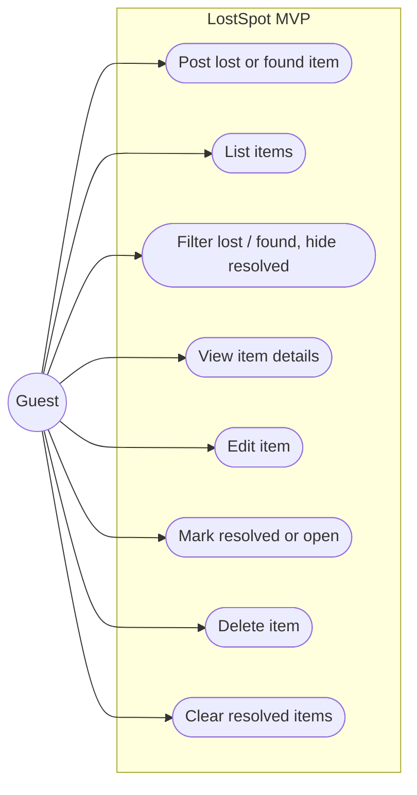
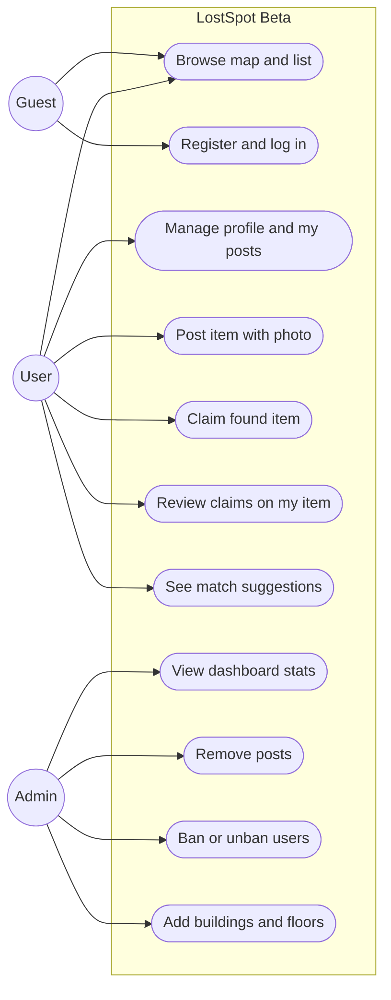
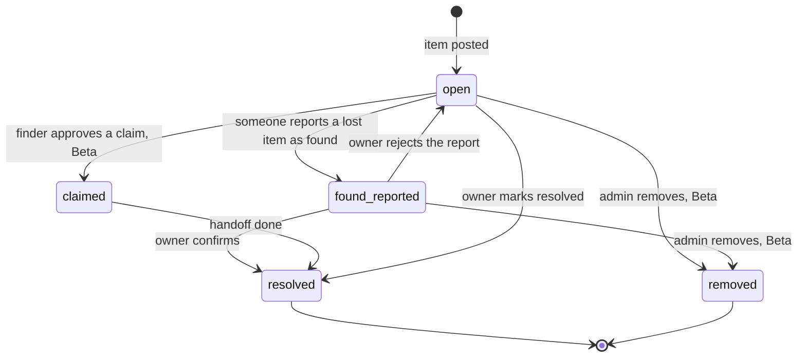

# Software Requirements Specification (SRS): LostSpot

| | |
|---|---|
| **Product** | LostSpot |
| **Document** | Software Requirements Specification (SRS) |
| **Version** | 1.2 |
| **Date** | 6 November 2026 |
| **Author** | Rifat |
| **Related docs** | [PRD](01-prd.md) · [TDD](03-tdd.md) |

---

## 1. Introduction

### 1.1 Purpose

This document lists what LostSpot must do (functional requirements) and how well it must do it (non-functional requirements). It is the reference for building and checking the system. Every requirement has an ID, a release (MVP or Beta) and a link back to a user story in the [PRD](01-prd.md).

### 1.2 Scope

LostSpot is a web app where people post lost and found items with where and when they happened. The MVP covers item CRUD (create, list, view, update including resolve, delete) without accounts. Beta adds accounts, roles, building floor maps with pins and areas, claims with a verification question, match suggestions, photos and admin tools. Out of scope: automated tests, CI/CD, native apps, notifications, chat, indoor positioning.

### 1.3 Definitions

| Term | Meaning |
|---|---|
| **CRUD** | Create, Read, Update, Delete. |
| **REST** | An API style where resources are reached by URL and HTTP methods (`GET`, `POST`, `PATCH`, `DELETE`). |
| **JWT** | JSON Web Token. A signed token that proves who the user is. |
| **Refresh token** | A long-lived token used to get a new access token without logging in again. |
| **RBAC** | Role-based access control. What a user can do depends on their role. |
| **Item** | A lost or found post. Its `type` is `lost` or `found`. |
| **Location** | Free text saying where the item was lost or found, for example "CSE Building, Floor 2, near Lab 1" (MVP). |
| **Date happened** | The day the item was lost or found (`date_happened`). |
| **Returned** | The item is back with its owner (`is_returned = true`). |
| **Pin** | An exact point on a floor plan, stored as `x` and `y` between 0 and 1 (Beta). |
| **Lost area** | A circle on the floor plan (centre `x`, `y` and `radius`) showing where the owner thinks the item was lost (Beta). |
| **Found report** | A note from someone saying they found a lost item (Beta). |
| **Claim** | A request from a user saying a found item is theirs, with an answer to the verification question (Beta). |
| **Match** | A found item that fits a lost item by floor, category, area and time (Beta). |
| **Owner / poster** | The person who created a post. |

### 1.4 Roles

| Role | Release | Description |
|---|---|---|
| `guest` | MVP, Beta | Not logged in. In the MVP everyone is a guest. |
| `user` | Beta | Logged-in account with a verified university email. |
| `admin` | Beta | User with moderation and management rights. |

"Owner" is not a role. It means the user who created a given item. Some actions are allowed only for the owner of that item.

## 2. Overall description

### 2.1 Use cases, MVP

### 2.2 Use cases, Beta

An admin can also do everything a user can.

### 2.3 Item status

In the MVP an item is either open or returned (`is_returned`), and either can be changed back. The full status flow below arrives in Beta.

| Status | Meaning | Applies to |
|---|---|---|
| `open` | Still lost or still waiting for its owner. | lost, found |
| `found_reported` | Someone says they found this lost item. | lost |
| `claimed` | Finder approved a claim; handoff pending. | found (Beta) |
| `resolved` | Item is back with its owner. Hidden from the map by default. | lost, found |
| `removed` | Taken down by an admin. Hidden everywhere except the admin view. | lost, found (Beta) |

## 3. Functional requirements

### 3.1 MVP

| ID | Requirement | Release | Story |
|---|---|---|---|
| FR-01 | A guest shall be able to create an item with `kind` (`lost` or `found`), `item_name`, `location` and `date_happened`, plus an optional `description` and `contact`. The system returns `201` with the new item. | MVP | US-01, US-02 |
| FR-02 | A new item shall get the next number as its `id`, `is_returned = false`, and `created_at` and `updated_at` set to the current time. | MVP | US-01, US-02 |
| FR-03 | The system shall reject a `date_happened` in the future with `400`. | MVP | US-01, US-02, US-05 |
| FR-04 | The system shall list items newest first. | MVP | US-03 |
| FR-05 | The list shall accept an optional `kind` filter (`lost` or `found`). | MVP | US-03 |
| FR-06 | The list shall accept an optional `search` word and return items whose name, location or description contains it (not case sensitive). | MVP | US-09 |
| FR-07 | The system shall return one item by id, or `404` with "No item with id N". | MVP | US-04 |
| FR-08 | A guest shall be able to update an item by sending the whole item (including `is_returned`); `updated_at` is set to the current time. | MVP | US-05, US-06 |
| FR-09 | A guest shall be able to delete an item. The system returns `200` with a message, or `404` if it doesn't exist. | MVP | US-07 |
| FR-10 | The frontend shall ask for confirmation before deleting. | MVP | US-07 |
| FR-11 | The frontend shall hide or show returned items with a switch. | MVP | US-08 |
| FR-12 | Invalid input shall return `422` with the field and the reason. | MVP | US-01, US-05 |
| FR-13 | Items shall be stored in Supabase PostgreSQL in production and in a SQLite file locally. | MVP | US-03 |
| FR-14 | Interactive API docs shall be served at `/api/docs`. | MVP | – |

### 3.2 Beta

| ID | Requirement | Release | Story |
|---|---|---|---|
| FR-15 | A guest shall be able to register with name, email and password. Only emails from allowed university domains are accepted. | Beta | US-10 |
| FR-16 | A user shall be able to log in and receive an access token and a refresh token. | Beta | US-11 |
| FR-17 | A user shall be able to get a new token pair with a valid refresh token; the old refresh token is revoked (rotation). | Beta | US-11 |
| FR-18 | A user shall be able to log out, which revokes their refresh token. | Beta | US-11 |
| FR-19 | A user shall be able to view their profile and change their name. | Beta | US-12 |
| FR-20 | A user shall be able to change their password by giving the current one. All their refresh tokens are revoked afterwards. | Beta | US-12 |
| FR-21 | A user shall be able to list all their own items. | Beta | US-13 |
| FR-22 | Creating an item shall require login. The item gets an `owner_id`; edit, delete, resolve and reopen are allowed for the owner or an admin. | Beta | US-13 |
| FR-23 | The owner shall be able to upload one photo per item (JPEG, PNG or WebP, max 2 MB). | Beta | US-17 |
| FR-24 | When posting a found item, the finder may add a verification question and a secret answer. The secret answer is shown only to the finder and admins. | Beta | US-14 |
| FR-25 | A user who is not the finder shall be able to submit one claim per found item, with an answer and a short message. | Beta | US-14 |
| FR-26 | The finder shall be able to list the claims on their item, seeing each answer next to the expected answer. | Beta | US-15 |
| FR-27 | The finder shall be able to approve a claim (item moves to `claimed`, other pending claims are rejected) or reject it. | Beta | US-15 |
| FR-28 | Contact details shall be visible only to logged-in users. After approval, the claimant can see the finder's contact and handoff note. | Beta | US-15 |
| FR-29 | For a lost item, the system shall return suggested found items on the same floor and in the same category, whose pin is inside the lost area and whose found time is between `time_from` and 48 hours after `time_to`, sorted by distance. | Beta | US-16 |
| FR-30 | An admin shall be able to view dashboard stats: items by type and status, resolution rate, items per building, items in the last 7 days and average time to resolve. | Beta | US-18 |
| FR-31 | An admin shall be able to remove any item (status `removed`). | Beta | US-19 |
| FR-32 | An admin shall be able to list users and ban or unban them. A banned user cannot log in, refresh tokens or post. | Beta | US-20 |
| FR-33 | An admin shall be able to create buildings and add floors with a floor plan image. | Beta | US-21 |
| FR-34 | The system shall enforce the permission matrix in section 6 on every Beta endpoint. | Beta | US-18 – US-21 |
| FR-35 | The system shall list buildings and their floors, each with a floor plan image and size. | Beta | US-23 |
| FR-36 | A lost item shall have an area (`x`, `y`, `radius`) and a found item a pin (`x`, `y`) on a floor, set by clicking the floor plan. | Beta | US-22 |
| FR-37 | The system shall show the open items of a floor on its map: found items as pins, lost items as circles. | Beta | US-23 |

## 4. Non-functional requirements

| ID | Category | Requirement | Release |
|---|---|---|---|
| NFR-01 | Performance | The item list endpoint responds in under 500 ms (p95) for up to 1,000 items, not counting serverless cold starts. | MVP |
| NFR-02 | Performance | The item list page loads in under 2 seconds on a normal connection. | MVP |
| NFR-03 | Usability | Posting an item takes one form and under a minute for a first-time user. | MVP |
| NFR-04 | Usability | The UI works on screens from 360 px wide (phones) to desktop. | MVP |
| NFR-05 | Security | The update and delete routes check that the item exists first and answer `404` otherwise. | MVP |
| NFR-06 | Security | All traffic is served over HTTPS. | MVP |
| NFR-07 | Security | Secrets (database URL, JWT secret, storage keys) are stored in environment variables and never committed to Git. | MVP |
| NFR-08 | Security | All input is validated on the server; invalid input returns `422`. | MVP |
| NFR-09 | Maintainability | Backend code for items is in one folder, split into router, service, repository, models and schemas, with a short comment at the top of each file. OpenAPI docs are served at `/api/docs`. | MVP |
| NFR-10 | Privacy | The post form says that contact details are shown publicly. Contact is optional. | MVP |
| NFR-11 | Security | Passwords are hashed with Argon2id. | Beta |
| NFR-12 | Security | Access tokens expire after 15 minutes; refresh tokens after 7 days and are rotated on use. | Beta |
| NFR-13 | Security | After 5 failed logins an account is locked for 15 minutes. | Beta |
| NFR-14 | Security | Item creation is limited to 10 per hour per user, and claims to 5 per hour per user. | Beta |
| NFR-15 | Security | CORS allows only the frontend origin. Responses include basic security headers (`X-Content-Type-Options`, `X-Frame-Options`, `Referrer-Policy`). | Beta |
| NFR-16 | Privacy | Contact details and secret answers are never returned to guests. | Beta |
| NFR-17 | Maintainability | Database schema changes are made through Alembic migrations. | Beta |

## 5. Validation rules

| Field | Rule | Release |
|---|---|---|
| `kind` | `lost` or `found`; required | MVP |
| `item_name` | 1 to 100 characters after trimming spaces; required | MVP |
| `location` | 1 to 150 characters after trimming spaces; required | MVP |
| `date_happened` | A date (`YYYY-MM-DD`), not in the future (`400`); required | MVP |
| `description` | Optional, up to 500 characters; empty text is saved as `null` | MVP |
| `contact` | Optional, up to 100 characters; empty text is saved as `null` | MVP |
| `is_returned` | `true` or `false`; required on update | MVP |
| Item id in the path | A whole number (`422` otherwise) | MVP |
| `category` | One of `keys`, `phone`, `wallet`, `id_card`, `bag`, `electronics`, `clothing`, `bottle`, `books`, `other` | Beta |
| `floor_id` | Must exist | Beta |
| `x`, `y` | Number from 0 to 1 | Beta |
| `radius` | Required for lost items, from 0.01 to 0.5. Must be empty for found items. | Beta |
| `email` | Valid email ending in an allowed domain (`ALLOWED_EMAIL_DOMAINS`) | Beta |
| `password` | At least 8 characters with at least one letter and one digit | Beta |
| `name` | 2 to 60 characters | Beta |
| Photo | JPEG, PNG or WebP, at most 2 MB | Beta |
| `verification_question` | Up to 120 characters | Beta |
| `secret_answer` | Up to 60 characters; required if a question is given | Beta |
| Claim `answer` | 1 to 200 characters | Beta |
| Claim `message` | Up to 300 characters | Beta |

## 6. Beta permission matrix

✅ allowed · ❌ not allowed · "own" means only on the user's own item.

| Action | Guest | User | Admin |
|---|---|---|---|
| Browse map, list, item details (no contact) | ✅ | ✅ | ✅ |
| See contact details | ❌ | ✅ | ✅ |
| Register / log in | ✅ | – | – |
| View and edit own profile | ❌ | ✅ | ✅ |
| Create item | ❌ | ✅ | ✅ |
| Edit, delete, resolve, reopen item | ❌ | own | ✅ |
| Upload photo | ❌ | own | ✅ |
| Report lost item as found | ❌ | ✅ (not own) | ✅ |
| Claim found item | ❌ | ✅ (not own) | ✅ |
| View claims and secret answer | ❌ | own | ✅ |
| Approve / reject claim | ❌ | own | ✅ |
| See match suggestions | ❌ | own | ✅ |
| Dashboard stats | ❌ | ❌ | ✅ |
| Remove any item | ❌ | ❌ | ✅ |
| List, ban, unban users | ❌ | ❌ | ✅ |
| Add buildings and floors | ❌ | ❌ | ✅ |

## 7. Status codes

| Code | When |
|---|---|
| `200 OK` | Successful read, update or delete (MVP delete returns a message) |
| `201 Created` | Item, claim, user, building or floor created |
| `204 No Content` | Successful delete or logout |
| `400 Bad Request` | Request is well formed but breaks a rule (MVP: date in the future; Beta: claiming your own item) |
| `401 Unauthorized` | Missing or invalid token (Beta) |
| `403 Forbidden` | Wrong role, not the owner, or banned user (Beta) |
| `404 Not Found` | Item, building, floor, claim or user does not exist (or is `removed`, for non-admins) |
| `409 Conflict` | Email already registered or invalid status change (Beta) |
| `413 Payload Too Large` | Photo larger than 2 MB |
| `422 Unprocessable Entity` | Validation failed |
| `429 Too Many Requests` | Rate limit hit or account locked after failed logins |
| `500 Internal Server Error` | Unexpected server error |

## 8. Acceptance criteria

| ID | Given | When | Then | Covers |
|---|---|---|---|---|
| AC-01 | The app is open | A guest posts a lost item with a name, location and today's date | `201` is returned and the item appears at the top of the list | FR-01, FR-02, FR-04 |
| AC-02 | The app is open | A guest posts an item with an empty name or location | `422` is returned and nothing is saved | FR-12 |
| AC-03 | The app is open | A guest posts an item dated three days from now | `400` is returned with "The date cannot be in the future" | FR-03 |
| AC-04 | Lost and found items exist | A guest picks "Found" | Only found items are shown | FR-05 |
| AC-05 | An item's location is "Library" | A guest searches for `library` | That item is in the results | FR-06 |
| AC-06 | An item exists | A guest edits its name and saves | The name changes and `updated_at` is newer | FR-08 |
| AC-07 | An open item exists | A guest clicks "Mark as returned" | `is_returned` becomes `true`, and the item disappears when "Hide returned" is on | FR-08, FR-11 |
| AC-08 | An item exists | A guest deletes it, then requests it again | The delete returns `200` and the request returns `404` | FR-07, FR-09 |
| AC-09 | A guest registers | The email is not from an allowed domain | `422` is returned and no account is created | FR-15 |
| AC-10 | A user has a valid refresh token | They call refresh | A new token pair is returned and the old refresh token no longer works | FR-17 |
| AC-11 | A user fails login 5 times | They try again with the right password | `429` is returned until 15 minutes have passed | FR-16, NFR-13 |
| AC-12 | A found item has a verification question | Another user submits a claim with an answer | The claim is saved as `pending` and the finder sees the answer next to the expected one | FR-25, FR-26 |
| AC-13 | A found item has two pending claims | The finder approves one | The item becomes `claimed`, the other claim becomes `rejected`, and the approved claimant can see the contact and handoff note | FR-27, FR-28 |
| AC-14 | A user tries to claim their own found item | They submit the claim | `400` is returned | FR-25 |
| AC-15 | A lost key area covers a found key pin on the same floor, found within the time window | The owner opens matches for the lost item | The found key is in the list | FR-29 |
| AC-16 | A user is banned by an admin | They try to log in | `403` is returned | FR-32 |
| AC-17 | A logged-in `user` (not admin) | They call an `/admin` endpoint | `403` is returned | FR-34 |

## 9. Traceability

| Story | Requirements | Endpoint(s) |
|---|---|---|
| US-01 | FR-01, FR-02, FR-03, FR-12 | `POST /api/items` |
| US-02 | FR-01, FR-02, FR-03 | `POST /api/items` |
| US-03 | FR-04, FR-05, FR-13 | `GET /api/items?kind=` |
| US-04 | FR-07 | `GET /api/items/{id}` |
| US-05 | FR-03, FR-08, FR-12 | `PUT /api/items/{id}` |
| US-06 | FR-08 | `PUT /api/items/{id}` |
| US-07 | FR-09, FR-10 | `DELETE /api/items/{id}` |
| US-08 | FR-11 | – (done in the browser) |
| US-09 | FR-06 | `GET /api/items?search=` |
| US-10 |
| FR-16 | A user shall be able to log in and receive an access token and a refresh token. | Beta | US-11 |
| FR-17 | A user shall be able to get a new token pair with a valid refresh token; the old refresh token is revoked (rotation). | Beta | US-11 |
| FR-18 | A user shall be able to log out, which revokes their refresh token. | Beta | US-11 |
| FR-19 | A user shall be able to view their profile and change their name. | Beta | US-12 |
| FR-20 | A user shall be able to change their password by giving the current one. All their refresh tokens are revoked afterwards. | Beta | US-12 |
| FR-21 | A user shall be able to list all their own items. | Beta | US-13 |
| FR-22 | Creating an item shall require login. The item gets an `owner_id`; edit, delete, resolve and reopen are allowed for the owner or an admin. | Beta | US-13 |
| FR-23 | The owner shall be able to upload one photo per item (JPEG, PNG or WebP, max 2 MB). | Beta | US-17 |
| FR-24 | When posting a found item, the finder may add a verification question and a secret answer. The secret answer is shown only to the finder and admins. | Beta | US-14 |
| FR-25 | A user who is not the finder shall be able to submit one claim per found item, with an answer and a short message. | Beta | US-14 |
| FR-26 | The finder shall be able to list the claims on their item, seeing each answer next to the expected answer. | Beta | US-15 |
| FR-27 | The finder shall be able to approve a claim (item moves to `claimed`, other pending claims are rejected) or reject it. | Beta | US-15 |
| FR-28 | Contact details shall be visible only to logged-in users. After approval, the claimant can see the finder's contact and handoff note. | Beta | US-15 |
| FR-29 | For a lost item, the system shall return suggested found items on the same floor and in the same category, whose pin is inside the lost area and whose found time is between `time_from` and 48 hours after `time_to`, sorted by distance. | Beta | US-16 |
| FR-30 | An admin shall be able to view dashboard stats: items by type and status, resolution rate, items per building, items in the last 7 days and average time to resolve. | Beta | US-18 |
| FR-31 | An admin shall be able to remove any item (status `removed`). | Beta | US-19 |
| FR-32 | An admin shall be able to list users and ban or unban them. A banned user cannot log in, refresh tokens or post. | Beta | US-20 |
| FR-33 | An admin shall be able to create buildings and add floors with a floor plan image. | Beta | US-21 |
| FR-34 | The system shall enforce the permission matrix in section 6 on every Beta endpoint. | Beta | US-18 – US-21 |
| FR-35 | The system shall list buildings and their floors, each with a floor plan image and size. | Beta | US-23 |
| FR-36 | A lost item shall have an area (`x`, `y`, `radius`) and a found item a pin (`x`, `y`) on a floor, set by clicking the floor plan. | Beta | US-22 |
| FR-37 | The system shall show the open items of a floor on its map: found items as pins, lost items as circles. | Beta | US-23 |

## 4. Non-functional requirements

| ID | Category | Requirement | Release |
|---|---|---|---|
| NFR-01 | Performance | The item list endpoint responds in under 500 ms (p95) for up to 1,000 items, not counting serverless cold starts. | MVP |
| NFR-02 | Performance | The item list page loads in under 2 seconds on a normal connection. | MVP |
| NFR-03 | Usability | Posting an item takes one form and under a minute for a first-time user. | MVP |
| NFR-04 | Usability | The UI works on screens from 360 px wide (phones) to desktop. | MVP |
| NFR-05 | Security | The update and delete routes check that the item exists first and answer `404` otherwise. | MVP |
| NFR-06 | Security | All traffic is served over HTTPS. | MVP |
| NFR-07 | Security | Secrets (database URL, JWT secret, storage keys) are stored in environment variables and never committed to Git. | MVP |
| NFR-08 | Security | All input is validated on the server; invalid input returns `422`. | MVP |
| NFR-09 | Maintainability | Backend code for items is in one folder, split into router, service, repository, models and schemas, with a short comment at the top of each file. OpenAPI docs are served at `/api/docs`. | MVP |
| NFR-10 | Privacy | The post form says that contact details are shown publicly. Contact is optional. | MVP |
| NFR-11 | Security | Passwords are hashed with Argon2id. | Beta |
| NFR-12 | Security | Access tokens expire after 15 minutes; refresh tokens after 7 days and are rotated on use. | Beta |
| NFR-13 | Security | After 5 failed logins an account is locked for 15 minutes. | Beta |
| NFR-14 | Security | Item creation is limited to 10 per hour per user, and claims to 5 per hour per user. | Beta |
| NFR-15 | Security | CORS allows only the frontend origin. Responses include basic security headers (`X-Content-Type-Options`, `X-Frame-Options`, `Referrer-Policy`). | Beta |
| NFR-16 | Privacy | Contact details and secret answers are never returned to guests. | Beta |
| NFR-17 | Maintainability | Database schema changes are made through Alembic migrations. | Beta |

## 5. Validation rules

| Field | Rule | Release |
|---|---|---|
| `kind` | `lost` or `found`; required | MVP |
| `item_name` | 1 to 100 characters after trimming spaces; required | MVP |
| `location` | 1 to 150 characters after trimming spaces; required | MVP |
| `date_happened` | A date (`YYYY-MM-DD`), not in the future (`400`); required | MVP |
| `description` | Optional, up to 500 characters; empty text is saved as `null` | MVP |
| `contact` | Optional, up to 100 characters; empty text is saved as `null` | MVP |
| `is_returned` | `true` or `false`; required on update | MVP |
| Item id in the path | A whole number (`422` otherwise) | MVP |
| `category` | One of `keys`, `phone`, `wallet`, `id_card`, `bag`, `electronics`, `clothing`, `bottle`, `books`, `other` | Beta |
| `floor_id` | Must exist | Beta |
| `x`, `y` | Number from 0 to 1 | Beta |
| `radius` | Required for lost items, from 0.01 to 0.5. Must be empty for found items. | Beta |
| `email` | Valid email ending in an allowed domain (`ALLOWED_EMAIL_DOMAINS`) | Beta |
| `password` | At least 8 characters with at least one letter and one digit | Beta |
| `name` | 2 to 60 characters | Beta |
| Photo | JPEG, PNG or WebP, at most 2 MB | Beta |
| `verification_question` | Up to 120 characters | Beta |
| `secret_answer` | Up to 60 characters; required if a question is given | Beta |
| Claim `answer` | 1 to 200 characters | Beta |
| Claim `message` | Up to 300 characters | Beta |

## 6. Beta permission matrix

✅ allowed · ❌ not allowed · "own" means only on the user's own item.

| Action | Guest | User | Admin |
|---|---|---|---|
| Browse map, list, item details (no contact) | ✅ | ✅ | ✅ |
| See contact details | ❌ | ✅ | ✅ |
| Register / log in | ✅ | – | – |
| View and edit own profile | ❌ | ✅ | ✅ |
| Create item | ❌ | ✅ | ✅ |
| Edit, delete, resolve, reopen item | ❌ | own | ✅ |
| Upload photo | ❌ | own | ✅ |
| Report lost item as found | ❌ | ✅ (not own) | ✅ |
| Claim found item | ❌ | ✅ (not own) | ✅ |
| View claims and secret answer | ❌ | own | ✅ |
| Approve / reject claim | ❌ | own | ✅ |
| See match suggestions | ❌ | own | ✅ |
| Dashboard stats | ❌ | ❌ | ✅ |
| Remove any item | ❌ | ❌ | ✅ |
| List, ban, unban users | ❌ | ❌ | ✅ |
| Add buildings and floors | ❌ | ❌ | ✅ |

## 7. Status codes

| Code | When |
|---|---|
| `200 OK` | Successful read, update or delete (MVP delete returns a message) |
| `201 Created` | Item, claim, user, building or floor created |
| `204 No Content` | Successful delete or logout |
| `400 Bad Request` | Request is well formed but breaks a rule (MVP: date in the future; Beta: claiming your own item) |
| `401 Unauthorized` | Missing or invalid token (Beta) |
| `403 Forbidden` | Wrong role, not the owner, or banned user (Beta) |
| `404 Not Found` | Item, building, floor, claim or user does not exist (or is `removed`, for non-admins) |
| `409 Conflict` | Email already registered or invalid status change (Beta) |
| `413 Payload Too Large` | Photo larger than 2 MB |
| `422 Unprocessable Entity` | Validation failed |
| `429 Too Many Requests` | Rate limit hit or account locked after failed logins |
| `500 Internal Server Error` | Unexpected server error |

## 8. Acceptance criteria

| ID | Given | When | Then | Covers |
|---|---|---|---|---|
| AC-01 | The app is open | A guest posts a lost item with a name, location and today's date | `201` is returned and the item appears at the top of the list | FR-01, FR-02, FR-04 |
| AC-02 | The app is open | A guest posts an item with an empty name or location | `422` is returned and nothing is saved | FR-12 |
| AC-03 | The app is open | A guest posts an item dated three days from now | `400` is returned with "The date cannot be in the future" | FR-03 |
| AC-04 | Lost and found items exist | A guest picks "Found" | Only found items are shown | FR-05 |
| AC-05 | An item's location is "Library" | A guest searches for `library` | That item is in the results | FR-06 |
| AC-06 | An item exists | A guest edits its name and saves | The name changes and `updated_at` is newer | FR-08 |
| AC-07 | An open item exists | A guest clicks "Mark as returned" | `is_returned` becomes `true`, and the item disappears when "Hide returned" is on | FR-08, FR-11 |
| AC-08 | An item exists | A guest deletes it, then requests it again | The delete returns `200` and the request returns `404` | FR-07, FR-09 |
| AC-09 | A guest registers | The email is not from an allowed domain | `422` is returned and no account is created | FR-15 |
| AC-10 | A user has a valid refresh token | They call refresh | A new token pair is returned and the old refresh token no longer works | FR-17 |
| AC-11 | A user fails login 5 times | They try again with the right password | `429` is returned until 15 minutes have passed | FR-16, NFR-13 |
| AC-12 | A found item has a verification question | Another user submits a claim with an answer | The claim is saved as `pending` and the finder sees the answer next to the expected one | FR-25, FR-26 |
| AC-13 | A found item has two pending claims | The finder approves one | The item becomes `claimed`, the other claim becomes `rejected`, and the approved claimant can see the contact and handoff note | FR-27, FR-28 |
| AC-14 | A user tries to claim their own found item | They submit the claim | `400` is returned | FR-25 |
| AC-15 | A lost key area covers a found key pin on the same floor, found within the time window | The owner opens matches for the lost item | The found key is in the list | FR-29 |
| AC-16 | A user is banned by an admin | They try to log in | `403` is returned | FR-32 |
| AC-17 | A logged-in `user` (not admin) | They call an `/admin` endpoint | `403` is returned | FR-34 |

## 9. Traceability

| Story | Requirements | Endpoint(s) |
|---|---|---|
| US-01 | FR-01, FR-02, FR-03, FR-12 | `POST /api/items` |
| US-02 | FR-01, FR-02, FR-03 | `POST /api/items` |
| US-03 | FR-04, FR-09, FR-13 | `GET /api/items` |
| US-04 | FR-05 | `GET /api/items/{id}` |
| US-05 | FR-03, FR-06, FR-12 | `PATCH /api/items/{id}` |
| US-06 | FR-07 | `PATCH /api/items/{id}` |
| US-07 | FR-08 | `DELETE /api/items/{id}` |
| US-08 | FR-09, FR-10 | `DELETE /api/items/{id}` (once per resolved item) |
| US-09 | FR-04, FR-11 | `GET /api/items?offset=&limit=` |
| US-10 | FR-15 | `POST /api/auth/register` |
| US-11 | FR-16, FR-17, FR-18 | `POST /api/auth/login`, `POST /api/auth/refresh`, `POST /api/auth/logout` |
| US-12 | FR-19, FR-20 | `GET /api/users/me`, `PATCH /api/users/me`, `POST /api/users/me/password` |
| US-13 | FR-21, FR-22 | `GET /api/users/me/items` and the item endpoints |
| US-14 | FR-24, FR-25 | `POST /api/items`, `POST /api/items/{id}/claims` |
| US-15 | FR-26, FR-27, FR-28 | `GET /api/items/{id}/claims`, `POST /api/claims/{id}/approve`, `POST /api/claims/{id}/reject` |
| US-16 | FR-29 | `GET /api/items/{id}/matches` |
| US-17 | FR-23 | `POST /api/items/{id}/photo` |
| US-18 | FR-30, FR-34 | `GET /api/admin/stats` |
| US-19 | FR-31, FR-34 | `DELETE /api/admin/items/{id}` |
| US-20 | FR-32, FR-34 | `GET /api/admin/users`, `POST /api/admin/users/{id}/ban`, `POST /api/admin/users/{id}/unban` |
| US-21 | FR-33, FR-34 | `POST /api/admin/buildings`, `POST /api/admin/buildings/{id}/floors` |
| US-22 | FR-36 | `POST /api/items`, `PATCH /api/items/{id}` |
| US-23 | FR-35, FR-37 | `GET /api/buildings`, `GET /api/buildings/{id}/floors`, `GET /api/items?floor_id=` |
