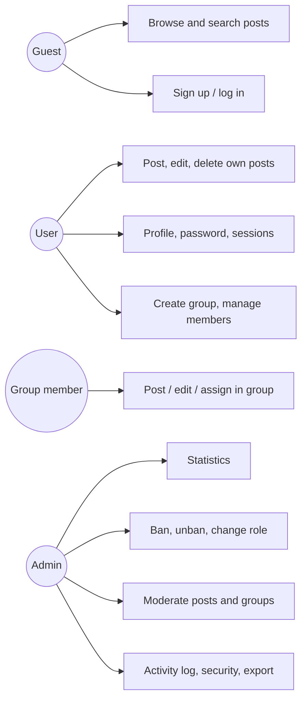
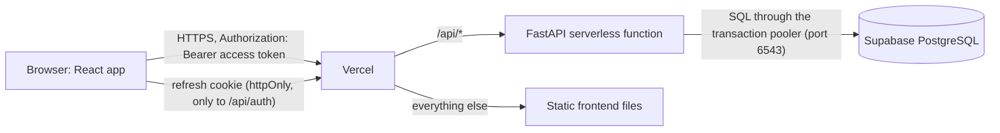
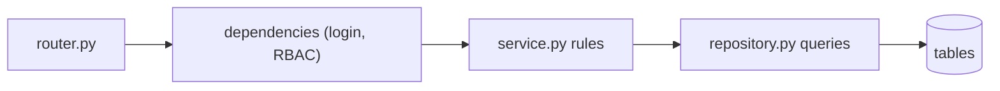
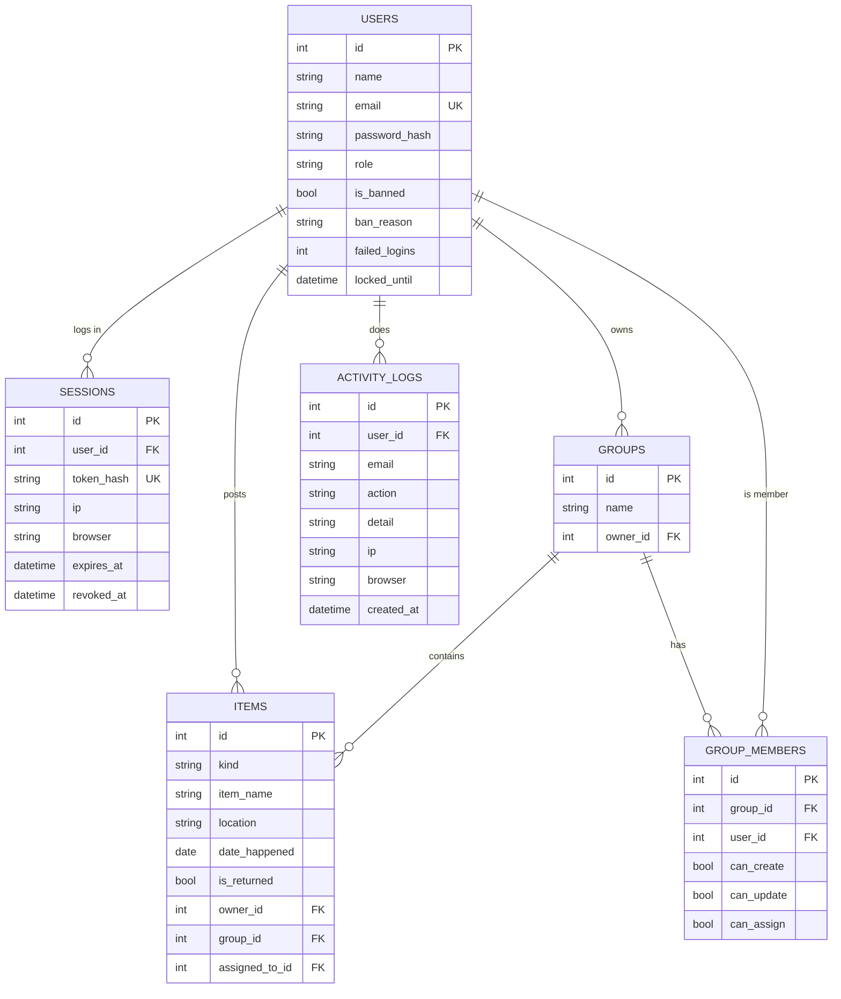
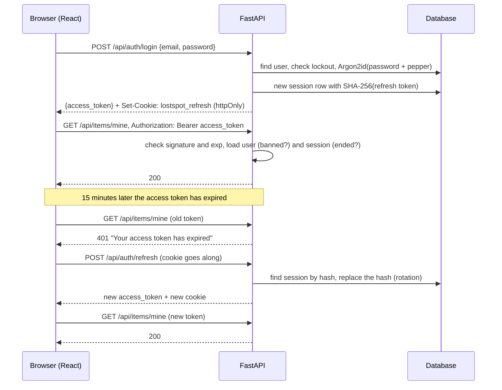
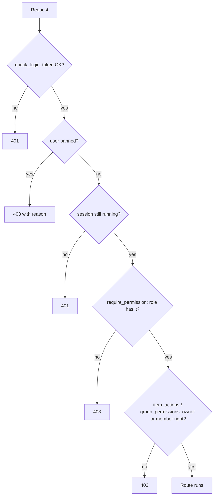
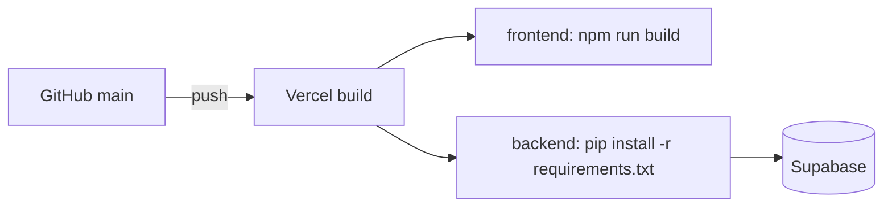

# LostSpot: Final Project Report

| | |
|---|---|
| **Course** | CSE309, Autumn 2026 |
| **Student** | Rifat Abdullah Khan (2311188) |
| **Project** | LostSpot, a campus lost and found board |
| **Repository** | https://github.com/Rifat-stack/2311188_LostSpot |
| **Report date** | 26 November 2026 |

This report describes the finished project: what it is for (Part A), the exact requirements (Part B), how it is built (Part C), screenshots of the live app (Part D), and how the work was done (Part E). The earlier planning documents are in `docs/01-prd.md`, `docs/02-srs.md` and `docs/03-tdd.md`.

---

## 1. Executive summary

### 1.1 Project overview

LostSpot is a web app where students post things they lost or found on campus, together with where and when it happened. Anyone can read the board. To post, a student makes an account. Students can also work together in **groups**, for example the lost and found desk of one building, where the group owner decides what each member may do.

The app is built with **React + TypeScript** (Vite, React-Bootstrap) for the frontend and **FastAPI + SQLModel** for the backend. Data is stored in **Supabase PostgreSQL**, and everything runs on **Vercel**.

### 1.2 What was built since the mid-term

At the mid-term, LostSpot was a single-user CRUD app: anyone could create, edit and delete any post. For the final version I added:

- **Accounts**: sign up, log in, log out, profile and password change.
- **JWT authentication**: a 15-minute access token, plus a refresh token in an httpOnly cookie that rotates on every use. Each login is a session that can be listed and ended.
- **Password security**: Argon2id hashing with a server-side pepper, lockout after 5 wrong passwords, and a limit per IP address.
- **RBAC**: two roles (`user`, `admin`) stored in the database and one permission module (`app/rbac.py`), used by every route.
- **Ownership**: posts belong to the person who made them, and only they (or an admin) can change them.
- **Groups**: members have their own `create`, `update` and `assign` permissions, and only the owner can rename the group, delete it or manage members.
- **Admin dashboard**: statistics, user management (search, filters, paging, ban, unban, bulk ban, role change, ending sessions), content moderation, an activity log, a security view and CSV exports.
- **Quality**: a safe error handler, CORS limited to the frontend, `.env.example`, a startup migration for the live database, and 16 automated tests.

### 1.3 Live links

| What | Link |
|---|---|
| Frontend | https://2311188project-name.vercel.app |
| API | https://2311188project-name.vercel.app/api |
| API docs | https://2311188project-name.vercel.app/api/docs |
| Repository | https://github.com/Rifat-stack/2311188_LostSpot |
| Video demo | _(add the link)_ |

---

## Part A. Product requirements (PRD)

### A1. Problem

On a university campus, lost things are usually reported in Facebook groups or on notice boards. Posts get buried, nobody knows where an item was actually found, and anyone can post or delete anything. Lost and found desks (for example at a building's reception) have no shared place to track the things they hold and who is handling each one.

LostSpot gives every lost or found item one clear post, with what it is, where and when. Accounts make posts belong to someone, and groups let a desk team share the work with different permissions per person.

### A2. Users and roles

| Role | Who | What they do |
|---|---|---|
| Guest | Anyone who is not logged in | Read and search all posts |
| User | A student with an account | Post items, edit and delete their own posts, create and join groups, manage their profile and sessions |
| Group owner | The user who created a group | Everything in the group: rename, delete, add and remove members, set their permissions |
| Group member | A user added to a group | Whatever the owner allows: `create` (post in the group), `update` (edit group posts), `assign` (give a group post to a member) |
| Admin | A trusted staff member | The admin dashboard: statistics, users, bans, roles, moderation, activity log, exports |

### A3. Goals

| ID | Goal | How it is measured |
|---|---|---|
| G-01 | A student can post a lost or found item in under a minute | One form with 5 fields |
| G-02 | Nobody can change another person's post | Server returns 403 (tested in `test_rbac.py`) |
| G-03 | A desk team can share work safely | Group permissions enforced on the server for every action |
| G-04 | Admins can stop abuse quickly | A ban works on the user's very next request |
| G-05 | Every important event can be traced | Logins, failed logins, bans, deletes and exports are in the activity log with IP and browser |

### A4. Scope

**In scope:** accounts with JWT, roles, ownership, groups with member permissions, the admin dashboard, the activity log, CSV export, and deployment on Vercel with Supabase.

**Out of scope for this version:** floor maps of buildings, photo uploads, claiming an item with a secret question, email verification and password reset by email.

**Constraints:** the stack must stay React + TypeScript and FastAPI. Vercel runs the backend as serverless functions, so nothing can be kept in memory between requests. Rate limits and lockouts are therefore stored in the database.

### A5. User stories

| ID | As a... | I want to... | So that... |
|---|---|---|---|
| US-01 | guest | browse and search posts | I can check if someone found my thing |
| US-02 | guest | sign up with my email | I can post |
| US-03 | user | post a lost or found item | people can contact me |
| US-04 | user | edit, mark returned or delete my own posts | the board stays correct |
| US-05 | user | see only my own posts on one page | I can keep track of them |
| US-06 | user | change my name and password | my account stays mine |
| US-07 | user | see where I'm logged in and end a session | I can log out a lost phone |
| US-08 | user | create a group and add members with different permissions | a desk team can share work |
| US-09 | group member | post, edit or assign items in my group, as allowed | I can do my part |
| US-10 | admin | see statistics and search users | I know what is happening |
| US-11 | admin | ban and unban users with a reason, one or many at once | I can stop abuse |
| US-12 | admin | change a user's role and end their sessions | I can manage access |
| US-13 | admin | delete any posts or groups | I can remove bad content |
| US-14 | admin | read the activity log and the failed logins | I can spot attacks |
| US-15 | admin | export users, posts and activity as CSV | I can keep records |

---

## Part B. Software requirements (SRS)

### B1. Introduction

This part lists what the system must do, written so that each line can be tested. The readers are the instructor and anyone maintaining the code. In this document, a **record** means a lost or found post (`items` table), and a **session** means one login on one browser (`sessions` table).

### B2. Functional requirements

**Accounts and authentication**

| ID | Requirement |
|---|---|
| FR-01 | A guest can register with a name, an email and a password. Each email has one account (`409` otherwise). |
| FR-02 | A password has at least 8 characters, with at least one letter and one number (`422` otherwise). |
| FR-03 | Passwords are stored as Argon2id hashes of the password plus a server secret (pepper). |
| FR-04 | Login returns a JWT access token (15 minutes or less) with the user id, role and session id, and sets a refresh token in an httpOnly cookie. |
| FR-05 | Every protected request checks the token. A missing, invalid, changed or expired token returns `401`. |
| FR-06 | Refresh gives a new access token and a new refresh token, and the old refresh token stops working (rotation). |
| FR-07 | Logout ends the session at once: its access token and refresh token both stop working. |
| FR-08 | A user can list their active sessions and end any of them. |
| FR-09 | A user can change their name. |
| FR-10 | A user can change their password by giving the current one. A wrong current password returns `400` and is recorded. All other sessions are ended. |
| FR-11 | After 5 wrong passwords in a row, the account is locked for 15 minutes (`429`). After 20 failed logins from one IP address in 15 minutes, that IP gets `429`. |

**Records, ownership and groups**

| ID | Requirement |
|---|---|
| FR-12 | Anyone can list, search and open posts. Posting needs a login. |
| FR-13 | A post belongs to the user who made it. Only that user, an admin, or a group member with the right permission can change it. Anyone else gets `403`. |
| FR-14 | A user can list only their own posts (`/api/items/mine`). |
| FR-15 | A user can create a group and becomes its owner. |
| FR-16 | The owner can add members by email and give each one `create`, `update` and `assign`. |
| FR-17 | Members with `create` may post in the group, members with `update` may edit group posts, and members with `assign` may give a group post to a member. |
| FR-18 | Only the owner may rename or delete the group and manage members. A member may leave. Non-members can't open the group (`403`). |

**Admin**

| ID | Requirement |
|---|---|
| FR-19 | Every `/api/admin` route needs the admin role (`403` otherwise). |
| FR-20 | The overview shows users, admins, banned users, posts, groups, new ones in the last 7 days, failed logins and active sessions. |
| FR-21 | The users list has search, role and status filters, and pages. The detail shows the user's posts, groups, sessions and recent activity. |
| FR-22 | An admin can ban (with a reason) and unban users, also many at once, change roles and end a user's sessions. |
| FR-23 | An admin can't change their own role, and can't ban an admin. |
| FR-24 | A banned user is rejected on their very next request (`403` with the reason) and can't log in. |
| FR-25 | An admin can list all posts and groups with filters and delete one or many. |
| FR-26 | The activity log records signup, login, failed login, logout, profile and password changes, failed password changes, ended sessions, role changes, bans, unbans, deletes and exports, with user, IP address, browser and time. It can be filtered and searched. |
| FR-27 | The security view shows failed logins grouped by IP address and by account, and the locked accounts. |
| FR-28 | Users, posts and activity can be exported as CSV using the same filters as the screen. Each export is recorded. |

### B3. Non-functional requirements

| ID | Area | Requirement |
|---|---|---|
| NFR-01 | Security | No secret is in the repository. Only `.env.example` lists the names. |
| NFR-02 | Security | The refresh token is never readable by JavaScript (httpOnly, Secure on https, SameSite=Lax, path `/api/auth`). Only its SHA-256 hash is stored. |
| NFR-03 | Security | Errors never show a stack trace. Unexpected errors return `500` with a short message. |
| NFR-04 | Security | CORS only allows the origins in `FRONTEND_ORIGINS`. |
| NFR-05 | Consistency | Every error is `{"detail": ...}` with a fitting status code (400, 401, 403, 404, 409, 422, 429, 500). |
| NFR-06 | Usability | Pages show loading, error and empty states, and work on a phone. A logged-in user never sees the guest version flash while the session is restored. |
| NFR-07 | Reliability | Data is kept in Supabase PostgreSQL, not in a temporary file. |
| NFR-08 | Maintainability | Each feature has its own folder with the same layers (models, schemas, repository, service, dependencies, router), and all permission rules are in one file. |
| NFR-09 | Testing | Automated tests cover login, token rejection and the main RBAC rules. |

### B4. Roles and permission matrix

**Role permissions** (from `ROLE_PERMISSIONS` in `app/rbac.py`)

| Permission | Guest | User | Admin |
|---|:-:|:-:|:-:|
| Read posts | ✓ | ✓ | ✓ |
| `item:create` post items | | ✓ | ✓ |
| `group:create` make groups | | ✓ | ✓ |
| `admin:dashboard` statistics | | | ✓ |
| `users:manage` ban, roles, sessions | | | ✓ |
| `content:moderate` delete any post or group | | | ✓ |
| `activity:read` activity log, security view | | | ✓ |
| `data:export` CSV | | | ✓ |

**Ownership** (from `item_actions` in `app/rbac.py`)

| Action on a post | Poster | Admin | Group member with the permission | Group owner | Anyone else |
|---|:-:|:-:|:-:|:-:|:-:|
| Edit, mark returned | ✓ | ✓ | `update` | ✓ | 403 |
| Delete | ✓ | ✓ | | ✓ | 403 |
| Assign (group posts only) | | | `assign` | ✓ | 403 |

**Inside a group** (from `group_permissions` in `app/rbac.py`)

| Action | Owner | Member with `create` | Member with `update` | Member with `assign` | Not a member |
|---|:-:|:-:|:-:|:-:|:-:|
| Open the group | ✓ | ✓ | ✓ | ✓ | 403 |
| Post in the group | ✓ | ✓ | | | 403 |
| Edit group posts | ✓ | | ✓ | | 403 |
| Assign group posts | ✓ | | | ✓ | 403 |
| Rename, delete, manage members | ✓ | | | | 403 |

### B5. Use cases



| Use case | Main steps |
|---|---|
| Post an item | 1. User clicks "I lost something". 2. Fills the form, optionally picks a group. 3. Server checks login, `item:create`, and the group's `create` permission. 4. The post appears at the top of the feed. |
| Assign a group post | 1. A member with `assign` opens a group post. 2. Picks a member from the list. 3. Server checks `assign`, and that the person is in the group. 4. "Handled by" shows the name. |
| Ban a user | 1. Admin opens Users and ticks one or more users. 2. Clicks "Ban selected" and writes a reason. 3. Server skips admins, bans the rest, ends their sessions and records it. 4. The banned user's next request gets `403`, and the app sends them to the login page with the reason. |

### B6. Acceptance criteria

| ID | Given | When | Then |
|---|---|---|---|
| AC-01 | A registered user | they log in with the right password | they get an access token, and the refresh token is set as an httpOnly cookie |
| AC-02 | A protected route | it is called without a token, with a changed token, or with an expired token | `401` |
| AC-03 | A logged-in user | they log out and the old access token is used again | `401` |
| AC-04 | A used refresh token | it is used a second time | `401` |
| AC-05 | A user | they get the password wrong 5 times in a row | `429`, even with the right password, for 15 minutes |
| AC-06 | User A's post | user B tries to edit or delete it | `403` |
| AC-07 | A group member with only `create` | they try to edit someone else's group post | `403` |
| AC-08 | A group member who is not the owner | they try to rename or delete the group, or add a member | `403` |
| AC-09 | A normal user | they call any `/api/admin` route | `403` |
| AC-10 | An admin | they try to change their own role, or ban another admin | `403` |
| AC-11 | A logged-in user | an admin bans them, and they make another request | `403` with the ban reason |
| AC-12 | An admin on the activity page with filters | they click Export CSV | a CSV with only the filtered rows downloads, and an `export` event is recorded |

### B7. Traceability

| Requirement | Endpoint(s) | Test | Screenshot |
|---|---|---|---|
| FR-01, FR-02 | `POST /api/auth/register` | `conftest.new_account` | S1 |
| FR-04 | `POST /api/auth/login` | `test_login_gives_access_token_and_httponly_refresh_cookie` | S2 |
| FR-05 | every protected route | `test_missing_token…`, `test_tampered_token…`, `test_token_signed_with_another_secret…`, `test_expired_token…` | S8 |
| FR-06 | `POST /api/auth/refresh` | `test_refresh_rotates_the_refresh_token` | S9 |
| FR-07 | `POST /api/auth/logout` | `test_logout_ends_the_session_at_once` | |
| FR-08 | `GET/DELETE /api/users/me/sessions` | | S5 |
| FR-11 | `POST /api/auth/login` | `test_account_is_locked_after_five_wrong_passwords` | S16 |
| FR-13 | `PUT/DELETE /api/items/{id}` | `test_user_cannot_edit_or_delete_someone_elses_item` | S7 |
| FR-16 – FR-18 | `/api/groups/...`, `POST /api/items` | `test_group_member_permissions` | S4, S6 |
| FR-19 | `/api/admin/*` | `test_normal_user_cannot_open_the_admin_dashboard` | S7 |
| FR-22 – FR-24 | `/api/admin/users/...` | `test_admin_cannot_change_own_role_or_ban_an_admin`, `test_banned_user_is_rejected_on_the_next_request` | S11, S12 |
| FR-25 | `/api/admin/items`, `/api/admin/groups` | | S13 |
| FR-26 – FR-28 | `/api/admin/activity`, `/api/admin/security`, `/api/admin/export/*.csv` | | S14 – S17 |

---

## Part C. Technical design (TDD)

### C1. Technology stack

| Part | Tool | Why |
|---|---|---|
| Frontend | React 19, TypeScript, Vite | Typed components, fast build |
| UI | React-Bootstrap (Bootstrap 5) and my own CSS | Ready-made forms, tables, modals; my own sidebar layout and colours |
| Routing | React Router | One URL per page, guards for login and admin |
| Backend | FastAPI | Validation with Pydantic, dependency injection for the auth checks, automatic API docs |
| Database access | SQLModel (SQLAlchemy) | One class is both the table and a Pydantic model |
| Database | Supabase PostgreSQL (SQLite on my laptop) | Free hosted Postgres; no setup locally |
| Tokens | PyJWT (HS256) | Small and well known |
| Password hashing | pwdlib with Argon2id | The current recommended password hash |
| Tests | pytest with FastAPI's TestClient | Runs the real app against a temporary SQLite file |
| Hosting | Vercel | Frontend and backend from one repository |

### C2. System architecture



The browser loads the React app from Vercel. Every API call goes to `/api/...` on the same address, so Vercel sends it to the FastAPI function. Inside FastAPI, a request passes through the same layers in every feature:



### C3. Backend and frontend structure

```
backend/
├── main.py                 app, CORS, error handler, routers, tables
├── app/
│   ├── config.py           settings from environment variables
│   ├── database.py         engine, new-column migration, get_db()
│   ├── helpers.py          now_utc, client_ip, client_browser
│   ├── rbac.py             ALL permission rules: roles, ownership, groups
│   ├── users/              accounts, tokens, sessions
│   ├── items/              lost and found posts
│   ├── groups/             groups and members
│   ├── activity/           the activity log
│   └── admin/              the admin dashboard API
└── tests/                  pytest: test_auth.py, test_rbac.py

frontend/src/
├── main.tsx, App.tsx       start, routes and guards
├── AuthContext.tsx         who is logged in; restores the session on page load
├── api/client.ts           access token in memory, refresh on 401, error messages
├── api/{auth,items,groups,admin}.ts   one function per endpoint
├── components/             Layout, Sidebar (role menu), Guards, ItemRow, ItemFormDrawer, Pager, AskModal
└── pages/                  Home, Item, MyPosts, Groups, Group, Login, Signup, Profile, admin/*
```

Inside each backend feature folder, `models.py` holds the tables, `schemas.py` what the API accepts and returns, `repository.py` the queries, `service.py` the rules, `dependencies.py` the shared checks, and `router.py` the URLs.

### C4. Data model



`create_all()` makes new tables but never changes an existing one. The live `items` table came from the mid-term, so `add_missing_columns()` in `database.py` adds `owner_id`, `group_id` and `assigned_to_id` on start-up if they are missing. Old posts keep working and have no owner, so only an admin can change them.

### C5. API design

| Method and path | Who | Success | Errors |
|---|---|---|---|
| `POST /api/auth/register` | guest | 201 + token, cookie | 409, 422 |
| `POST /api/auth/login` | guest | 200 + token, cookie | 401, 403 (banned), 429 |
| `POST /api/auth/refresh` | cookie | 200 + new token, new cookie; 204 if no cookie | 401, 403 |
| `POST /api/auth/logout` | cookie | 200 | |
| `GET/PATCH /api/users/me` | user | 200 | 401, 422 |
| `PUT /api/users/me/password` | user | 200 | 400, 401, 422 |
| `GET /api/users/me/sessions`, `DELETE …/{id}` | user | 200 | 401, 404 |
| `GET /api/items`, `GET /api/items/{id}` | anyone | 200 | 404 |
| `GET /api/items/mine` | user | 200 | 401 |
| `POST /api/items` | `item:create` (+ group `create`) | 201 | 401, 403, 404, 422 |
| `PUT /api/items/{id}` | owner, admin, group `update` | 200 | 400, 401, 403, 404 |
| `DELETE /api/items/{id}` | owner, admin, group owner | 200 | 401, 403, 404 |
| `PUT /api/items/{id}/assign` | group `assign` | 200 | 400, 401, 403 |
| `GET/POST /api/groups` | user / `group:create` | 200 / 201 | 401 |
| `GET /api/groups/{id}` | member, admin | 200 | 403, 404 |
| `PATCH/DELETE /api/groups/{id}`, `…/members…` | owner (a member may remove themselves) | 200 / 201 | 400, 403, 404, 409 |
| `GET /api/admin/stats`, `/users`, `/users/{id}` | admin | 200 | 401, 403 |
| `POST /api/admin/users/{id}/ban`, `/unban`, `/revoke-sessions`, `PUT …/role`, `POST …/bulk-ban`, `/bulk-unban` | admin | 200 | 403 (self role, admin ban), 404 |
| `GET /api/admin/items`, `/groups`; `POST …/delete` | admin | 200 | 403 |
| `GET /api/admin/activity`, `/security` | admin | 200 | 403 |
| `GET /api/admin/export/{users,items,activity}.csv` | admin | 200 CSV | 403 |

### C6. JWT authentication design



| Access token claim | Meaning |
|---|---|
| `sub` | the user id |
| `role` | `user` or `admin` (used by the frontend; the server reads the role from the database) |
| `sid` | the session id, so logout and revoke work at once |
| `type` | always `access` |
| `iat`, `exp` | issued at, expires (15 minutes later, or less) |

| Where each secret lives | |
|---|---|
| Access token | Only in a JavaScript variable in `api/client.ts`. It is gone after a page reload, which is fine because the cookie gets a new one. |
| Refresh token | httpOnly cookie, only sent to `/api/auth`. In the database only its SHA-256 hash. |
| Password | Never stored. Argon2id hash of password + `PASSWORD_PEPPER`. |
| `JWT_SECRET`, `PASSWORD_PEPPER` | Vercel environment variables. The app refuses to issue tokens on Vercel if they are missing. |

When the page opens, `AuthContext` calls `/api/auth/refresh`. Until it answers, `App.tsx` shows a loading screen, so there is no flash of the guest view. A guest without a cookie gets `204`, which is not an error.

### C7. RBAC design



Roles are stored in the `role` column of the `users` table. Everyone signs up as `user`, and no API lets anyone make themselves an admin. The first admins were made by changing that column in Supabase. After that, admins can change roles in the dashboard, but never their own.

All the rules are in `backend/app/rbac.py`. A route asks for a role permission like this:

```python
@router.post("", response_model=ItemResponse, status_code=201)
def create_item(data: ItemCreate, user: User = Depends(require_permission(Permission.ITEM_CREATE)), ...):
```

`require_permission()` first runs `get_current_user` (login, ban, session), then looks the permission up in `ROLE_PERMISSIONS`. For one post or one group, the service calls `item_actions()` or `group_permissions()` and then `require_item_action()` or `require_group_permission()`, which raise `403` with a clear message. The API also sends the result as `allowed` (posts) or `my_permissions` (groups), so the frontend shows exactly the buttons the server would accept. The server still checks every request.

### C8. Admin dashboard design

| Page | What it shows | Server |
|---|---|---|
| Overview | 13 numbers | `GET /api/admin/stats` |
| Users | search, role and status filters, 10 per page, tick boxes for bulk ban and unban, CSV | `GET /api/admin/users`, `POST …/bulk-ban`, `…/bulk-unban`, `GET …/export/users.csv` |
| User detail | role, ban/unban with reason, end sessions, posts, groups, sessions, recent activity | `GET /api/admin/users/{id}` and the actions |
| Content | posts (search, kind, status) and groups (search), delete one or many, CSV | `/api/admin/items`, `/api/admin/groups` |
| Activity log | search (email, IP, browser, detail), action filter, per-user view, CSV | `/api/admin/activity` |
| Security | failed logins by IP and by account for 1, 7 or 30 days; locked accounts | `/api/admin/security` |

The activity log records these events: `signup`, `login`, `login_failed`, `logout`, `profile_update`, `password_change`, `password_change_failed`, `session_revoke`, `role_change`, `ban`, `unban`, `item_delete`, `group_delete` and `export`.

### C9. Security design and threats

| Threat | Defence | Where |
|---|---|---|
| Stolen database | Argon2id + pepper; refresh tokens stored only as hashes | `users/security.py` |
| Password guessing | Lockout after 5 wrong passwords; 20 failures per IP per 15 minutes | `users/service.py: log_in` |
| Forged or changed token | HS256 signature with `JWT_SECRET`, only HS256 accepted, `exp`, `sub` and `sid` required | `users/security.py: decode_access_token` |
| Stolen access token | Lives 15 minutes; logout and revoke end its session at once | `users/dependencies.py: check_token` |
| Stolen refresh token | httpOnly (no JavaScript access), rotation (an old one fails), path `/api/auth` | `users/router.py` |
| Cross-site requests | SameSite=Lax cookie; CORS only for `FRONTEND_ORIGINS` | `users/router.py`, `main.py` |
| Changing other people's data | Ownership and group checks on the server | `rbac.py` |
| Admin locking themselves out, or one admin attacking another | Can't change own role, can't ban admins | `admin/service.py` |
| Banned user staying in | User loaded from the database on every request; ban also ends sessions | `users/dependencies.py`, `admin/service.py` |
| Leaking internals | Generic `500` handler, password hash never sent | `main.py`, `admin/service.py` |
| Secrets in Git | Only `.env.example`; the app refuses to run auth on Vercel without the secrets | `config.py` |

### C10. Deployment on Vercel



`vercel.json` sends `/api/*` to the FastAPI service and everything else to the frontend, with a fallback to `index.html` so reloads and deep links work.

| Environment variable | Purpose |
|---|---|
| `DATABASE_URL` | Supabase transaction pooler URL (port 6543) |
| `JWT_SECRET` | signs access tokens |
| `PASSWORD_PEPPER` | added to passwords before hashing |
| `FRONTEND_ORIGINS` | allowed origin for CORS (the Vercel URL) |
| `ACCESS_TOKEN_MINUTES` | optional, 15 at most (set to 1 only to film token expiry) |
| `DEMO_LOGINS` | optional: the test accounts listed on the login page (`label\|email\|password;…`), so the passwords are never in the repository |

### C11. Testing

Run with `cd backend` then `python -m pytest`. The tests use a fresh SQLite file, never the real database.

| Test | Checks |
|---|---|
| `test_login_gives_access_token_and_httponly_refresh_cookie` | login works; the refresh token is only in an httpOnly cookie |
| `test_wrong_password_is_rejected` | 401 |
| `test_account_is_locked_after_five_wrong_passwords` | 429, also with the right password |
| `test_missing_token_is_rejected` | 401 |
| `test_tampered_token_is_rejected` | 401 |
| `test_token_signed_with_another_secret_is_rejected` | 401 |
| `test_expired_token_is_rejected` | 401 "Your access token has expired" |
| `test_refresh_rotates_the_refresh_token` | new cookie; the old one gives 401 |
| `test_logout_ends_the_session_at_once` | the old access token and the old refresh token give 401 |
| `test_normal_user_cannot_open_the_admin_dashboard` | 403 |
| `test_admin_can_open_the_admin_dashboard` | 200 |
| `test_user_cannot_edit_or_delete_someone_elses_item` | 403, the owner can |
| `test_guest_cannot_post` | 401 |
| `test_group_member_permissions` | create, update and owner-only rules, non-member 403 |
| `test_admin_cannot_change_own_role_or_ban_an_admin` | 403 |
| `test_banned_user_is_rejected_on_the_next_request` | 403 and no login |

Result: **16 passed**.

---

## Part D. Evidence: screenshots of the live app

All screenshots are taken on the deployed Vercel URL.

### D1. User side
- **S1** Sign up page
- **S2** Home page as a logged-in user (sidebar shows the role and the menu)
- **S3** Posting an item into a group ("Post as" choice)
- **S4** Group page as the owner (member permission checkboxes)
- **S5** Profile with "Where you are logged in" (sessions)
- **S6** Group page as a member with only `create`

### D2. Security behaviour
- **S7** A request denied by RBAC: a normal user opening `/admin` ("No access"), and the `403` in the Network tab
- **S8** An expired token rejected: the Network tab showing `401 "Your access token has expired"`
- **S9** The refresh that follows: `POST /api/auth/refresh` → 200, then the request repeated → 200

### D3. Admin dashboard
- **S10** Overview statistics
- **S11** Users with filters and bulk ban
- **S12** User detail of a banned user
- **S13** Content moderation
- **S14** Activity log with a filter
- **S15** CSV export (the downloaded file)
- **S16** Security view
- **S17** A banned user sent to the login page with the reason

### D4. Deployment
- **S18** Vercel project with the deployment from `main`
- **S19** Vercel environment variable names (values hidden)
- **S20** API docs at `/api/docs`

### D5. Tests
- **S21** `python -m pytest` output: 16 passed

---

## Part E. Project management and conclusion

### E1. How to run and test

1. Backend: `cd backend`, `python -m venv .venv`, activate it, `pip install -r requirements-dev.txt`, then `fastapi dev main.py`.
2. Frontend: `cd frontend`, `npm install`, `npm run dev`, then open http://localhost:5173.
3. To make an admin, change the user's `role` to `admin` in the `users` table (Supabase Table Editor online, or any SQLite viewer for `backend/lostspot.db` on your computer).
4. Tests: `cd backend`, `python -m pytest`.

### E2. GitHub work

| Issue | Pull request | Work |
|---|---|---|
| #2 | #3 | PRD, SRS, TDD and README |
| #4 | #5, #6 | Mid-term MVP: item CRUD API and UI, then the rewrite in my own style |
| #7 | #8 | Final project: JWT, RBAC, groups, admin dashboard, tests, this report |

### E3. Limitations

- The access token is lost on a page reload and is fetched again with the cookie. This costs one extra request per page load.
- Rate limiting uses the activity log table, which is simple but not as fast as a cache like Redis.
- There is no email verification or "forgot password" yet.
- Posts from before accounts existed have no owner, so only admins can change them.

### E4. Future work

1. Password reset by email, because a locked-out user now needs an admin.
2. Building floor maps with pins, the original idea of LostSpot.
3. Claiming a found item with a secret question.
4. Photos on posts.
5. Detecting reuse of an old refresh token, and then ending all of that user's sessions.

### E5. Sources, libraries and tools

| Source | Used for |
|---|---|
| FastAPI, SQLModel, Pydantic docs | API, models, validation, dependencies |
| PyJWT, pwdlib (Argon2) docs | tokens and password hashing |
| React, React Router, React-Bootstrap docs | frontend |
| OWASP cheat sheets (authentication, session management, password storage) | security choices |
| Course reference project (smarter-todo) | the expected level of features; no code copied |
| AI assistant (Claude) | _Describe here honestly how you used it, as your course allows: for example, explaining concepts, suggesting and reviewing code, and drafting documents that you then checked and edited._ |
